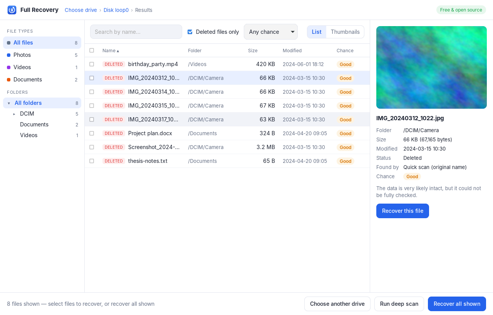
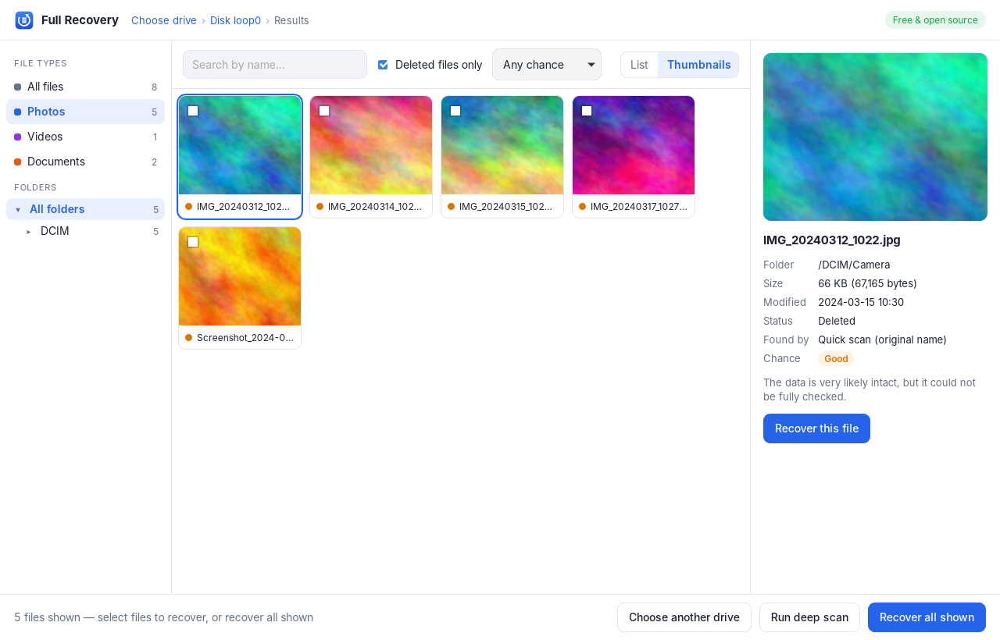
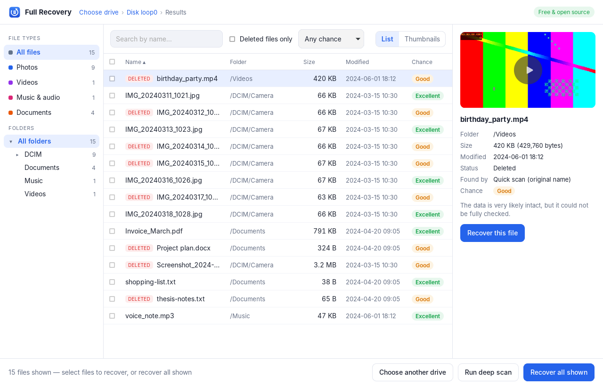

# Full Recovery

Free and open-source data recovery for **Windows, macOS, Linux and Android**.
Get back deleted photos, videos, music, documents and more from hard disks,
USB drives, SD cards and memory cards, even after formatting.

No payments, no "preview only" limits, no accounts.

> **Status:** early development. The desktop app (Windows, macOS, Linux) and a
> command-line tool work today. The Android app is next (see [Roadmap](#roadmap)).



## Desktop app

1. **Choose a drive**, memory card or USB stick (or a disk image file).
2. **Quick scan** finds deleted files with their original names, folders and
   dates in seconds. **Deep scan** finds files by their content, even after
   formatting, and double-checks what the quick scan found.
3. **Look before you recover:** filter by type, search by name, browse
   folders, see photos as thumbnails, and preview photos, videos, music and
   text. Every file shows its chance of recovery.
4. **Recover** the files you want to a folder on another drive.

| Thumbnails of deleted photos | Video preview |
|---|---|
|  |  |

Reading drives needs administrator rights: Windows asks for them when the app
starts. On macOS and Linux, start it from a terminal with `sudo` (Linux:
`sudo -E full-recovery`), or add yourself to the `disk` group on Linux.

## What works now

- **Undelete with original names:** recovers deleted files *with their names,
  folders and dates* from **NTFS** (Windows), **FAT12/16/32** and **exFAT**
  (USB drives, SD cards, cameras, phones), including files inside deleted
  folders.
- **Partitions:** reads MBR and GPT partition tables (using the backup GPT if
  the main one is damaged) and **finds lost or deleted partitions**, even when
  a partition's first sector is destroyed.
- **Deep scan (file carving):** finds files by their content, so it works even
  when the file system is formatted, damaged or missing.
- **Recovery confidence** for every file:
  - `high`: verified (structure and checksums, or the file system's own
    records show the data is untouched)
  - `medium`: very likely fine, but could not be fully verified
  - `low`: damaged, or partly overwritten by newer files
- **Drive imaging for failing drives:** copy a dying drive once, skipping bad
  sectors, then recover from the copy without stressing the drive again.
- **Read-only and crash-safe:** the drive being recovered is never written to,
  and damaged disks are handled without crashing (tested with thousands of
  corrupted disks). On Linux the tool refuses to save recovered files onto the
  disk being recovered.

### File types found by deep scan

| Type     | Formats                                                    |
|----------|------------------------------------------------------------|
| Photo    | JPG, PNG, GIF, BMP, WebP, HEIC (iPhone), AVIF, CR3 (Canon) |
| Video    | MP4, MOV, 3GP, AVI, MKV, WebM, OGV                         |
| Audio    | WAV, M4A, OGG, Opus                                        |
| Document | PDF, DOCX, XLSX, PPTX, ODT, ODS, ODP, ODG, EPUB            |
| Archive  | ZIP, 7Z, APK, JAR                                          |
| Database | SQLite (contacts, messages, app data)                      |

Undelete works for every file type. Run `fullrecovery types` for the deep scan list.

## Install

Download the installer for your computer from the
[Releases page](https://github.com/snb-dev/Full-recovery/releases):

- **Windows:** `.msi` or `-setup.exe`
- **macOS:** `.dmg` (the app is not signed yet: right-click it and choose
  *Open* the first time)
- **Linux:** `.AppImage` (any distribution) or `.deb` (Ubuntu, Debian)

### Build from source

You need [Rust](https://rustup.rs). The command-line tool:

```sh
git clone https://github.com/snb-dev/Full-recovery
cd Full-recovery
cargo build --release
# The program is at target/release/fullrecovery
```

The desktop app also needs [Node.js](https://nodejs.org) and, on Linux, the
WebKitGTK libraries (`sudo apt install libwebkit2gtk-4.1-dev libgtk-3-dev librsvg2-dev`):

```sh
cd apps/desktop
npm install
npx tauri build      # installers end up in target/release/bundle
```

## Command-line tool

Everything the app does is also available from the command line.

> **Most important rule:** stop using the drive you want to recover from, and
> always save recovered files to a **different** drive. New data overwrites
> deleted files.

**Deleted a file by mistake?** Undelete it with its original name and folder:

```sh
# See the partitions on the drive
fullrecovery partitions /dev/sdb

# List deleted files (names, sizes, dates, recovery confidence)
fullrecovery files /dev/sdb --deleted

# Recover all deleted files, keeping their folders and names
fullrecovery undelete /dev/sdb --out /media/backup/recovered

# Only files whose path contains "photos", from partition 2
fullrecovery undelete /dev/sdb --partition 2 --path photos --out ./recovered
```

**Formatted drive, or partition gone?**

```sh
# Look for lost partitions, then undelete from them
fullrecovery partitions /dev/sdb --search
fullrecovery undelete /dev/sdb --search --out ./recovered

# Deep scan: finds files by their content, without names
fullrecovery recover /dev/sdb --out ./recovered

# Only photos and videos, only fully verified files
fullrecovery recover /dev/sdb --out ./recovered --types jpg,heic,mp4,mov --min-confidence high
```

**Failing drive** (clicking, very slow, read errors)? Copy it first, then
recover from the copy:

```sh
fullrecovery image /dev/sdb sdb.img
fullrecovery undelete sdb.img --out ./recovered
```

Drive names:

- **Linux:** `/dev/sdb`, `/dev/mmcblk0` (SD card), `/dev/nvme0n1`. Run with `sudo`.
- **macOS:** `/dev/rdisk2`. Find it with `diskutil list`. Run with `sudo`.
- **Windows:** `\\.\PhysicalDrive1` or `\\.\E:`. Run as Administrator.

Disk image files (`.img`, `.dd`, `.raw`) work on every system.

`undelete` keeps the original folders, names and dates. `recover` (deep scan)
saves files in folders by type (`photo/`, `video/`, ...). Both write a JSON
report listing every file with its size and confidence.

## What no recovery tool can do

These limits apply to every recovery program, paid ones included. We tell you
the truth instead of selling false hope:

- **SSDs and TRIM:** when a file is deleted on most SSDs (and on many phones),
  the drive erases the data itself soon after. Once that happens, nothing can
  bring it back. Act quickly and stop using the drive.
- **Modern Android phones:** since Android 10, internal storage is encrypted
  file by file. Deleting a file destroys its key, so its data can't be read.
  On phones, we can recover from SD cards, thumbnails and caches, app trash
  folders and backups. Apps that claim more are usually restoring backups.
- **Overwritten data:** if new files were saved over the old ones, the old
  data is gone.
- **First letters of short FAT names:** FAT overwrites the first letter of a
  deleted file's short (8.3) name, so `DATA.BIN` comes back as `_ATA.BIN`.
  Long names are kept in full.
- **Encrypted drives** (BitLocker, FileVault, LUKS) need their key or password.

## Roadmap

1. **Core engine** ✅: deep scan, 30+ formats, confidence scores, drive imaging
2. **File systems** ✅: undelete with original names and folders from NTFS,
   FAT12/16/32 and exFAT; MBR/GPT; lost partition search
3. **Desktop app** ✅ (Windows, macOS, Linux): drive list, quick and deep scan,
   thumbnails and previews of photos, videos, music and text, filters, search,
   folder tree, recovery chance per file, installers
4. **Android app:** SD card and storage scan, thumbnail and cache recovery,
   deeper scan on rooted phones
5. **More file systems:** ext4 (Linux, Android), APFS and HFS+ (Mac),
   NTFS-compressed files
6. **Modern extras:** repair broken photos and videos, duplicate detection,
   drive health (SMART) warnings, "protection mode" that keeps deleted files
   safe for easy recovery, more formats (camera RAW, MP3, Office 97-2003, ...)

## Project layout

```
crates/core     recovery engine (library, used by every app)
crates/cli      `fullrecovery` command-line tool
apps/desktop    desktop app: Rust backend (src-tauri) and interface (ui)
```

The engine is written in Rust, which is fast and memory-safe, and the same
code builds for desktop and Android. The app uses [Tauri](https://tauri.app):
a small Rust program that shows its interface in the system's own web view,
so downloads stay small. Tauri also builds Android apps, so the Android app
can share the same interface.

## Contributing

Contributions are welcome! Before sending a change, run:

```sh
cargo fmt --all
cargo clippy --all-targets -- -D warnings
cargo test
```

To add a new file type, add a carver in `crates/core/src/carve/`, register it
in `carve/mod.rs`, and add a test file to `crates/core/src/fixtures.rs`.

File system tests use real disk images made by each file system's own tools
(`crates/core/tests/images/make-images.sh`). The desktop app has an
end-to-end test that uses the real app like a person would
(`apps/desktop/tests/run-e2e.sh`, Linux, needs root).

## License

Licensed under either of

- Apache License, Version 2.0 ([LICENSE-APACHE](LICENSE-APACHE))
- MIT license ([LICENSE-MIT](LICENSE-MIT))

at your option.

Unless you explicitly state otherwise, any contribution intentionally
submitted for inclusion in the work by you, as defined in the Apache-2.0
license, shall be dual licensed as above, without any additional terms or
conditions.
